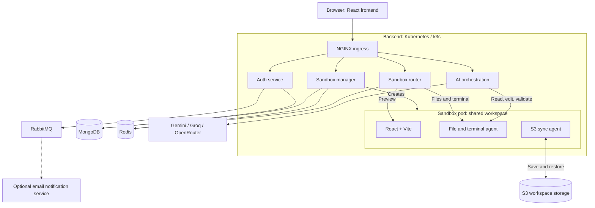

# Flowent

AI-powered cloud IDE for building React apps in your browser, powered by Google Gemini and Kubernetes.

[Demo](https://www.projectrs.me)

## The Problem & Solution

**The Problem:** Starting a frontend project usually means installing dependencies, configuring a development environment, and switching between an editor, terminal, browser, and AI chat.

**The Solution:** Flowent brings everything into one browser workspace. Each project runs in its own Kubernetes sandbox with a live preview, file explorer, terminal, and AI assistant that can read, edit, and validate code. Workspace files sync to S3 so projects can be reopened later.

## Architecture

- **Frontend:** React, Vite, and Tailwind CSS. Provides the workspace UI, live preview, terminal, and AI chat.
- **Backend:** Node.js services handle Google sign-in, projects, sandbox creation, request routing, and AI orchestration through LangChain.
- **Sandbox:** Each pod runs a React/Vite app, a file and terminal agent, and an S3 sync agent sharing the same workspace.
- **Storage:** MongoDB stores users and project metadata, Redis tracks sandbox activity, and S3 stores workspace files.



The portfolio deployment serves the frontend through S3 and CloudFront, with the backend on EC2 running k3s. An API Gateway/Lambda wake endpoint can start the demo server when it is stopped. The notification service is included in the repository but is not enabled in this deployment.

## Setup & Deployment

### 1. Backend

1. Prepare a Kubernetes cluster, container registry, MongoDB, Redis, RabbitMQ, and an S3 workspace bucket.
2. Use [`k8s/secrets.yml.example`](k8s/secrets.yml.example) as a reference to configure database connections, Google OAuth, JWT, AI provider keys, and AWS credentials in Kubernetes Secrets.
3. Follow the [deployment guide](portfolio/README.md) to build images and deploy the services. Update the repository's domain, OAuth callback, ingress, image registry, and bucket settings for your own environment.

### 2. Frontend

With Node.js and npm installed:

```bash
cd frontend
npm ci
npm run dev
```

Open `http://localhost:5173`. The frontend requires a configured backend; its `/api` proxy points to `http://127.0.0.1:80` in `frontend/vite.config.js`. Auth and sandbox hostnames currently use `projectrs.me` and must match your environment.

## Directory Structure

- `frontend/`: Browser workspace and landing page.
- `auth/`: Google sign-in and JWT authentication.
- `ai-orchestration/`: AI agent, provider fallbacks, and code-editing tools.
- `sandbox/server/`: Project management and sandbox lifecycle.
- `sandbox/router/`: Preview and agent request routing.
- `sandbox/agent/`: File operations, build validation, and terminal access.
- `sandbox/template/`: React/Vite starter workspace.
- `sandbox/sync-agent/`: Workspace persistence in S3.
- `notification/`: RabbitMQ-based login email notifications.
- `k8s/`: Kubernetes manifests.
- `portfolio/`: Deployment scripts, server wake logic, and deployment guide.

## Security Notes

- Keep API keys, database credentials, and JWT secrets on the backend. Never include them in the frontend build or commit local secret files.
- Configure HTTPS, OAuth callbacks, and allowed origins for your own domain before deployment.
